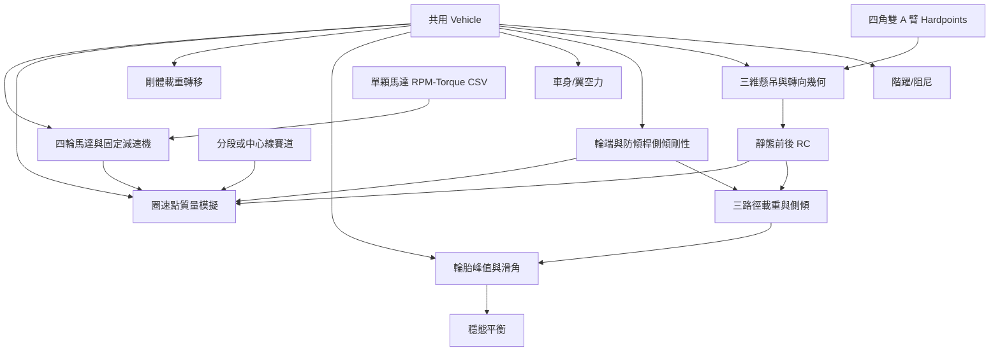

# 00　整體計算架構、共用符號與相依性

## 1. 說明範圍與閱讀方式

本工具由 FSAE 共用車輛參數、四角雙 A 臂硬點、馬達 CSV 與九個工作流程組成。前後固定雙 A 臂；四輪各一顆獨立馬達，前左右共用前固定減速比，後左右共用後固定減速比。每章的「實作」指目前 [vehicle_lab](../vehicle_lab/) 內的 Python 函式；公式中的近似、樣本數、上限、容許值與分段選擇均以程式為準。

各章使用局部符號表，例如 $c$ 在空力章可能表示翼弦、在阻尼章可能表示阻尼係數；同一章內定義明確，不應跨章省略下標直接混用。函式到章節對照見 [13](13_方程式與程式函式索引.md)。

沒有使用線上 API 執行物理計算，也沒有在執行時呼叫原網站。GUI 與 CLI 最後都進入 [workflows.py](../vehicle_lab/workflows.py) 的 `run_tool`。

## 2. 共用記號

| 記號 | 意義 | 核心單位 |
| --- | --- | --- |
| $g_0$ | 標準重力，固定 $9.80665$ | m/s² |
| $m$ | 整備質量與駕駛/額外載荷質量加總 | kg |
| $L$ | 軸距 | m |
| $t_f,t_r$ | 前/後輪距 | m |
| $h$ | 整車 CG 高度 | m |
| $w_f$ | 前軸靜態質量比例 | 無因次 |
| $m_s,m_u$ | 簧上/簧下質量 | kg |
| $k_w,k_s$ | 輪端/彈簧本體剛性 | N/m |
| $MR$ | 輪胎行程 / 彈簧行程，含需要時的搖臂倍率 | 無因次 |
| $K_\phi$ | 側傾剛性 | N·m/rad |
| $\rho,V$ | 空氣密度、車速 | kg/m³、m/s |
| $F_z,F_x,F_y$ | 法向/縱向/橫向輪胎力 | N |
| $\mathbf p$ | 三維點 | m |

座標是右手系：$x$ 向車頭、$y$ 向車輛左側、$z$ 向上；前軸位於 $x=0$、後軸 $x=-L$。四角順序固定為：

$$
(\mathrm{FL},\mathrm{FR},\mathrm{RL},\mathrm{RR}).
$$

單位換算：

$$
u_m=10^{-3}u_{mm},\qquad V_{m/s}=V_{km/h}/3.6,
$$

$$
\theta_{rad}=\frac\pi{180}\theta_{deg},\qquad
K_{Nm/deg}=\frac\pi{180}K_{Nm/rad}.
$$

## 3. 三種容易混淆的正負號

### 3.1 橫向

`ay_g` 正值表示左轉，車輛產生向左的橫向加速度，但負載移到右輪：

$$
a_y=g_0a_{y,g},\qquad
F_{zR}=F_{z0}+\Delta F,\quad F_{zL}=F_{z0}-\Delta F.
$$

圈速模型內部用曲率絕對值求輪胎能力，輸出 `lat_g` 才使用帶符號曲率。詳見第 11 章。

### 3.2 縱向

剛體與轉向頁 `ax_g` 正值為煞車：

$$
a_x^{physical}=-g_0\cdot{ax_g}.
$$

圈速 `long_g` 正值為加速：

$$
{long_g}=a_x^{physical}/g_0.
$$

### 3.3 懸吊與姿態

正跳動是接地點相對車身向上；正側傾輸入代表右側車身較低；負 camber 表示胎頂內傾；正 toe 為每輪 toe-in。轉向 `steer_deg` 為輪胎在 $x,y$ 平面的航向，正值向左。減震器圖的正/負力則是壓縮/回彈的 dyno 繪圖符號，不等於車身實際作用力方向。

## 4. 資料到計算的相依圖

此圖表示資料相依，不表示所有分頁會互相呼叫。圈速只重用輪胎峰值函式，沒有呼叫穩態平衡的 Magic Formula 滑角反解。

## 5. 九個工作流程的運算順序

| 工具 key | 主運算順序 | 主要章節 |
| --- | --- | --- |
| `step` | 軸向簧上質量 → 每角質量 → 輪端 SDOF → RK4 → 前後時間平移 → 指標與傳遞率 | 01、02 |
| `damper` | 桿速取樣 → 壓縮/回彈雙線性分段 → A/B 曲線 → 輪端係數摘要 | 03 |
| `geometry` | heave/roll/pitch → 各角目標行程 → 剛性連桿約束 → 姿態/IC/RC/anti → 另做行程掃描 | 04、05 |
| `steering` | 靜態 RC → rack 與後轉向比例 → 拉桿幾何 → scrub/trail → 輪荷/轉向力矩/桿力 → 掃描 | 06 |
| `roll` | RC → 前後側傾剛性 → 三路徑力矩 → 輪荷/側傾 → 輪胎平衡 → 幾何後處理 | 07、08 |
| `distribution` | RC → 三路徑力矩 → 輪荷/抓地損失 → 滑角/轉向量 → 可選防傾桿平衡搜尋 | 07、08 |
| `aero` | 密度/速度 → 車身力 → 翼係數 → 翼負載前後分配 → 軸荷/車高 → 速度掃描 | 09 |
| `rigid` | 靜態軸荷 → 縱向轉移 → 當下軸荷的橫向轉移 → 角輪荷 → 接地橢圓 | 10 |
| `lap` | 賽道/馬達 CSV/RC → 空間離散 → 各輪 RPM 與輪扭矩 → 逐輪抓地限扭 → 前向加速/反向液壓煞車 → 週期邊界 → 時間 | 11 |

每頁都先經過共用資料與 options 驗證。錯誤輸入會回報，不會一律自動截成可接受值。

## 6. 自動連動與不會自動連動的部分

### 6.1 有效的共用連動

- 改質量/前重/簧下質量會改階躍每角質量，也會改輪荷與圈速能力。
- 改輪端剛性會改自然頻率、側傾剛性、空力車高；改防傾桿會改橫向負載分配與圈速輪胎能力。
- 改硬點會改幾何姿態、RC；若勾選讀取幾何 RC，會影響側傾/分配/圈速。
- 「從階躍載入阻尼」會用 $MR^2$ 轉成 dyno 桿端；「高速係數寫回車輛」反向換回輪端。
- 空力密度助手會寫回共用 $\rho$；翼寫回按鈕只取代所選車軸的 $C_lA$。
- 馬達表的 `speed` 是馬達 RPM、`torque` 是單顆馬達 Nm；CSV 在一次圈速計算開始時載入並凍結，不在積分中途反覆重讀。

### 6.2 必須知道的相互獨立項

- 硬點不會自動推導或更新彈簧/減震器運動比；`MR` 是共用資料內的獨立輸入。
- 軸距、輪距、輪徑改變不會自動縮放已存在的硬點。
- `step` 使用的是共用輪端壓縮/回彈常係數，不使用 dyno 曲線的低速斜率或拐點。
- 側傾/分配的力學使用靜態 RC；變形後 RC 圖只是後處理，不閉環反覆改寫力矩。
- 空力車高不改幾何 RC、彈簧或空力係數；沒有 aero-map 與姿態耦合。
- 圈速不積分階躍/減震器動態，也不使用轉向齒條、Ackermann 或動態 camber 曲線。
- Magic Formula 的 B/C/E 改穩態滑角，但不改圈速峰值輪胎能力；圈速採獨立摩擦橢圓。
- 獨立翼不會自動加入圈速的阻力；共用車身 $C_DA$、$C_lA$ 才是圈速輸入。
- 四輪各自取馬達能力與該輪摩擦橢圓能力的較小值，不以差速器耦合左右輪；沒有換檔、引擎轉速下限、升檔罰時或自然進氣密度功率修正。

## 7. 共用數值小工具

### 7.1 等距取樣 `linspace`

[physics.py](../vehicle_lab/physics.py) 對 $N$ 點使用：

$$
x_j=a+(b-a)\frac{j}{N-1},\qquad j=0,\ldots,N-1.
$$

兩端包含在內；函式本身假定 $N>1$，各工作流程使用固定有效樣本數。

### 7.2 線性插值 `interpolate`

對已排序的 $(x_i,y_i)$：

$$
y(x)=y_i+(y_{i+1}-y_i)\frac{x-x_i}{x_{i+1}-x_i},
\qquad x_i\le x\le x_{i+1}.
$$

一般 `interpolate` 在區間外固定端點值，不線性外插。馬達 CSV 有獨立的高速邊界：超過 CSV 最大 RPM 時扭矩歸零。馬達表整理後的轉速必須嚴格遞增且不得重複，避免零分母。馬達原始扭矩可以為負，先保留原值插值，再將最大正向驅動能力取為 $s_T\max(0,T_{lookup})$；$s_T$ 是扭矩倍率，負樣本不作為再生煞車。

### 7.3 截值、缺值與例外

$$
\operatorname{clip}(x,a,b)=\min(b,\max(a,x)).
$$

截值只出現在程式明確指定的地方，如輪胎載重敏感性下限、法向力用於抓地時歸零、Newton 修正量限幅或畫布縮放錨點。不要把這個運算套用到未截斷的物理量：載重轉移會保留負輪荷，雙 A 臂 RC 仍可能位於 CG 以上，側傾角也可為負。

`None` 表示某指標沒有有效值；`ValueError` 表示輸入、數值退化、不可達或迭代未收斂。兩者與數字零不同。

## 8. 文件中的精度與驗證層級

公式是實作運算的數學表示；範例數字為浮點計算結果，表格可能顯示較少位數。機器浮點精度、數值收斂容許與物理模型準確度是三個不同概念：

1. 浮點捨入：例如同一守恆式可能有 $10^{-12}$ 量級殘差。
2. 求解容許：例如幾何殘差 $2\times10^{-7}$ m 或圈速節點速度 $10^{-5}$ m/s。
3. 模型準確度：仍取決於簡化模型和實測參數，不能由小殘差直接證明。

驗證範圍與這次修正見 [14](14_驗證結果與適用範圍.md)。所有可重現的圖表與 CSV 都是模型輸出，不是額外的實車量測資料。
