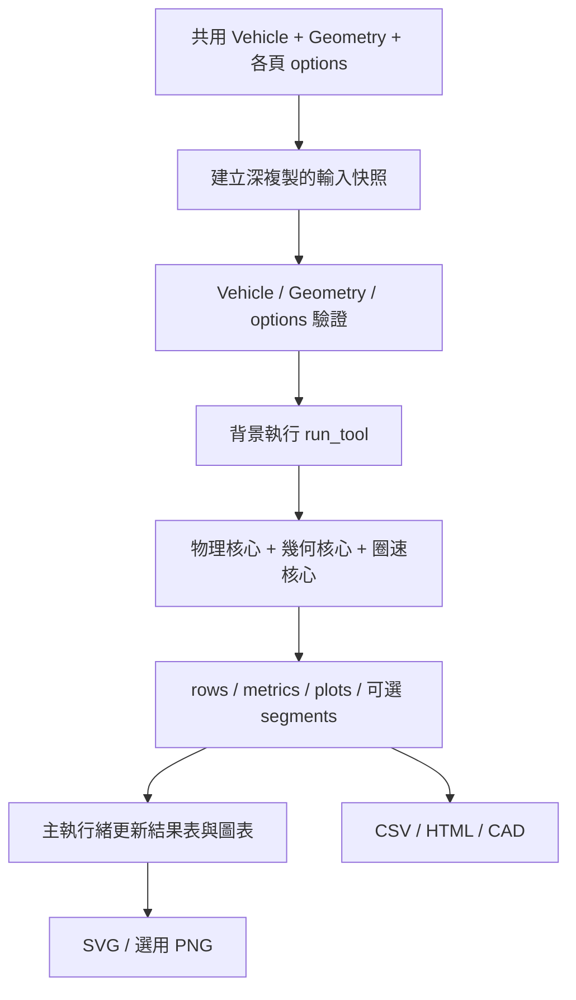

# 12　介面、圖表、資料匯出與驗證流程

物理模型外，工具還包含狀態管理、單位轉換、數值顯示、三維投影與 CAD 網格計算。本章對應 [gui.py](../vehicle_lab/gui.py)、[charts.py](../vehicle_lab/charts.py)、[export.py](../vehicle_lab/export.py)、[cli.py](../vehicle_lab/cli.py)、[models.py](../vehicle_lab/models.py) 的專案存讀。

## 1. 一次計算的資料流



GUI 將 `Vehicle`、幾何、賽道與 options 深複製後交給背景執行緒；Tk 元件只由主執行緒更新。`App.busy` 限制一次計算，背景結果由佇列送回，主執行緒每 80 ms 檢查。

`revision` 表示共用輸入版本；`result_revision` 表示某頁上次計算使用的版本。舊結果仍對應舊快照，修改輸入後必須重新計算。報告取 `result_vehicle` 和 `result_options`，不取當下可能已改變的車輛。

每個工作流程先呼叫 `Vehicle.validate`、`validate_geometry` 與 `validate_options`。例如即使某個純力學頁不使用幾何，它仍要求幾何資料結構有效。詳細欄位驗證見 [01](01_共用車輛_單位與剛性換算.md)。

## 2. 統一輸出結構

| Key | 內容 | 是否直接包含物理模型 |
| --- | --- | --- |
| `rows` | 結果資料列，完整 CSV 的來源 | 是 |
| `metrics` | 摘要鍵值，可能含數字、文字或 `None` | 是 |
| `plots` | 數值曲線名稱、x/y 資料與座標標籤 | 只是包裝既有數值 |
| `segments` | 可選的三維線段 $(\mathbf a,\mathbf b,\text{kind})$ | 由幾何解產生 |
| `note` | 模型說明 | 否 |
| `path_rows` 等 | 某些工具的額外分配/掃描資料 | 是，但未必就是預設結果 CSV |

`plot(rows,x,ys,...)` 只是從指定欄位取值，沒有重新擬合、平滑或插值。

GUI 結果表最多插入前 3000 列；原始 `rows` 沒有因此截斷，CSV 仍可匯出全部。HTML 報告則只顯示前 200 列。

## 3. 數值顯示與空值

`format_value` 對浮點數顯示 7 位有效數字：

$$
\text{display}(x)=\texttt{format}(x,\texttt{'.7g'}).
$$

這不會改變存於記憶體與 CSV 中的原始浮點值。`None` 顯示為 `—`，列表/字典以 JSON 文字顯示。

圖表只繪製有限數字：

$$
\mathrm{valid}(x)=(x\text{ 為 int 或 float})\land\mathrm{isfinite}(x).
$$

因此 `None`、非數字及 $\pm\infty$ 不繪製；遇到缺值時重設上一點，不跨越缺口連線。幾何不可達、輪胎飽和與尚未安定的空值，必須依各章節的定義解讀。

## 4. 五種幾何投影

三維點為 $\mathbf p=(x,y,z)$，投影後繪圖座標記為 $(u,v)$。

$$
\begin{array}{c|cc}
\text{投影}&u&v\\\hline
\text{Front}&-y&z\\
\text{Rear}&y&z\\
\text{Side}&x&z\\
\text{Top}&-y&x
\end{array}
$$

立體 `Iso` 使用方位角 $\alpha$、仰角 $\beta$：

$$
u=x\cos\alpha-y\sin\alpha,
$$

$$
v=z\cos\beta-(x\sin\alpha+y\cos\alpha)\sin\beta.
$$

初始 $\alpha=-0.65$ rad、$\beta=0.5$ rad。這是可旋轉的正交投影，沒有透視除法、攝影機焦距或隱藏面消除。線段的繪製順序依資料順序，不能用遮擋關係推論零件前後的精確實體關係。

幾何的原始三維座標與 CAD 匯出不會因投影改變。

## 5. 自動座標範圍與等比例

從所有有限資料取得 $x_{min},x_{max},y_{min},y_{max}$。若某方向跨度為零，以：

$$
d_x=\max(0.2|x_{max}|,1),\qquad
d_y=\max(0.2|y_{max}|,1)
$$

分別替代該方向跨度。然後 x 左右各加 $0.06d_x$、y 上下各加 $0.12d_y$ 的邊界。

若指定 `equal=True` 或圖中包含幾何線段，令繪圖區寬高為 $W_p,H_p$：

$$
r_p=\frac{W_p}{H_p},\qquad r_d=\frac{x_{max}-x_{min}}{y_{max}-y_{min}}.
$$

- 若 $r_d<r_p$，保持 y 範圍、置中擴大 x 跨度至 $(y_{max}-y_{min})r_p$。
- 否則保持 x 範圍、置中擴大 y 跨度至 $(x_{max}-x_{min})/r_p$。

這確保 x/y 每公尺的像素尺度相同，不改動物理資料。

## 6. 數值到畫布座標

畫布的有效大小先取 $W=\max(\texttt{winfo width},300)$、$H=\max(\texttt{winfo height},220)$，程式使用：

$$
l=85,\quad t=64,\quad r=W-35,\quad b=H-67.
$$

由 $(x,y)$ 換算成螢幕 $(X,Y)$：

$$
X=l+\frac{x-x_{min}}{x_{max}-x_{min}}(r-l),
$$

$$
Y=b-\frac{y-y_{min}}{y_{max}-y_{min}}(b-t).
$$

y 使用減號是因為畫布向下為正。滑鼠座標讀值是以上映射的反函式。

座標格線在兩軸各取 6 個等距標記；數值標籤使用 4 位有效數字。這些顯示捨入不參與任何力學計算。

## 7. 線段裁切

畫布線段用參數形式：

$$
\mathbf s(u)=\mathbf A+u(\mathbf B-\mathbf A),\qquad 0\le u\le1.
$$

令 $\mathbf B-\mathbf A=(d_x,d_y)$，對左右上下界建立：

$$
(p_k,q_k)=(-d_x,A_x-l),\ (d_x,r-A_x),\ (-d_y,A_y-t),\ (d_y,b-A_y).
$$

初值 $u_{low}=0,u_{high}=1$。依序更新：

$$
\begin{cases}
u_{low}\leftarrow\max(u_{low},q_k/p_k),&p_k<0,\\
u_{high}\leftarrow\min(u_{high},q_k/p_k),&p_k>0.
\end{cases}
$$

若 $|p_k|<10^{-12}$ 且 $q_k<0$，或 $u_{low}>u_{high}$，捨棄線段；平行且 $q_k\ge0$ 時直接略過該邊界、不做除法。其他情況繪製 $\mathbf s(u_{low})$ 到 $\mathbf s(u_{high})$。此裁切只處理螢幕範圍，不是 CAD 的幾何裁切。

## 8. 縮放、平移與旋轉

滾輪向上縮放因子 $f=0.85$，反方向為 $f=1/0.85$。先把滑鼠換為資料座標錨點 $(x_c,y_c)$，對每個邊界：

$$
x'_{bound}=x_c+f(x_{bound}-x_c),\qquad
y'_{bound}=y_c+f(y_{bound}-y_c).
$$

滑鼠位置比例會截在 $[0,1]$。拖曳平移：

$$
\Delta x_{data}=\Delta X\frac{x_{max}-x_{min}}{r-l},\qquad
\Delta y_{data}=\Delta Y\frac{y_{max}-y_{min}}{b-t},
$$

x 邊界減去 $\Delta x_{data}$，y 邊界加上 $\Delta y_{data}$。

在 `Iso` 投影時，拖曳改為：

$$
\alpha\leftarrow\alpha+0.01\Delta X,\qquad
\beta\leftarrow\operatorname{clip}(\beta+0.01\Delta Y,-1.3,1.3).
$$

旋轉後重算自動座標範圍。雙擊只重設視野，不重設共用車輛或硬點。

## 9. 播放預覽與物理模擬的界線

播放預覽每 80 ms 請求下一影格。以實際經過時間 $t$ 定義：

$$
p(t)=\sin(1.5t).
$$

| 目前視圖 | 播放時的輸入 |
| --- | --- |
| 幾何 | 四角共同 $u_i=0.7u_{sweep,max}p(t)$ |
| 轉向 | 前 rack $=r_{max}p(t)$，後 rack 按 `rear_percent` 比例 |
| 側傾 | $\phi(t)=p(t)\min(3^\circ,|\phi_{summary}|)$；摘要側傾為零時改採 $3^\circ$ 振幅 |

側傾預覽用 $u_i=-s_it_i\tan\phi/2$ 在底盤座標求解，沒有主結果世界座標旋轉或 roll-axis 高度修正。這是幾何播放，沒有積分側傾慣量或阻尼，也沒有重新計算該影格的輪荷。

一般數值曲線播放只是 5 秒掃完**第一條 series** 有效 x 範圍的掃描線：

$$
x_{head}(t)=x_{min,data}+(x_{max,data}-x_{min,data})\operatorname{frac}(t/5).
$$

它不代表五秒的物理時間；圈速曲線本身仍由前述數值模型決定。切換工具會在下一次播放回呼停止並恢復原始結果視圖；匯出前若仍在播放，也會先停下並恢復所選原始結果視圖。

## 10. CSV、專案 JSON 與報告

### 10.1 CSV

`write_csv` 將所有列的鍵依首次出現順序取聯集，作為欄名；UTF-8-SIG 編碼含 BOM。沒有捨入或單位重算。`None` 依 Python CSV 寫成空欄，字串以 CSV 規則處理。

「資料 CSV」取 `result['rows']`；「曲線 CSV」取目前選擇圖表的所有 series，使用欄位：`curve,x,y,x_unit,y_unit`。幾何線段圖沒有這種數值曲線；應至硬點編輯器匯出 mm 座標 CSV。

### 10.2 專案 JSON

FSAE 專案 schema 為 2，包含：

```text
schema = 2
vehicle = Vehicle 的資料欄位
geometry = 固定前後 double_wishbone 類型與四角雙 A 臂硬點
settings = 桌面各分頁的 options + track + track_name + 舊專案中的命令列工具 options（若有）
```

保存前驗證車輛，JSON 寫入設 `allow_nan=False`；讀取只接受 schema 2，不自動遷移舊引擎/變速專案。`Vehicle.from_dict` 拒絕未知欄位，缺少的現行欄位由 dataclass 預設值補齊；舊的 `gears`、`differential` 等欄位不會被默默忽略。GUI 載入還會驗證雙 A 臂幾何靜態解、賽道與各頁 options。

簧下質量保存為 `unsprung_front` / `unsprung_rear`，均為每輪 kg。舊 schema 2 的四角簧下欄位是唯一明確支援的舊欄位轉換：必須四欄完整、非負且有限，各軸左右取平均，保留每軸總量；拒絕新舊混用或不完整資料。轉換不修改傳入的資料字典，新專案只輸出兩個欄位。轉換方程式見第 01 章。

專案保存 `motor_curve_csv` 路徑，不內嵌一份可編輯扭力曲線。CSV 為馬達能力的來源，應和專案一起保存；相對路徑以工具根目錄解析。每次圈速計算開始時凍結該次讀取曲線，檔案若在模擬中途改變不會改寫該次計算。

共用車輛介面由 `select_motor_csv` 選擇 CSV、`preview_motor_curve` 預覽原始馬達曲線，不再編輯引擎扭力點陣列。報告與圈速摘要保留 `motor_csv_source`、`motor_csv_sha256`、`motor_csv_rows` 與負扭矩樣本數；保存來源檔及雜湊，才可辨識兩次模擬是否真的使用相同馬達表。提供的資料含一個小負扭矩樣本，原始曲線不刪改；最大驅動能力是在原值插值後取 $\max(0,T_{lookup})$，不是在匯入時先重畫非負曲線，也沒有把負值當作再生煞車能力。

共用質量、尺寸變更不會自動重建既有硬點。這是避免任意縮放已量測座標的資料行為；使用者需自行同步。

### 10.3 HTML / PDF

HTML 包含摘要、模型註記、當下圖表 SVG、輸入快照及前 200 列結果。文字經 HTML escaping，不會把輸入名稱當作 HTML 程式執行。時間戳記採執行電腦的本地時間。

PDF 由使用者用瀏覽器列印產生，工具沒有自己的 PDF 排版或單獨數值求解。輸入快照與當前結果可用於重現計算。

CLI 摘要 JSON 使用 Python 預設的 `json.dumps` 數值行為；若某個理論界限為無限大，可能寫出 `Infinity`，嚴格 JSON 讀取器未必接受。這和專案 JSON 的 `allow_nan=False` 不同。

## 11. SVG 與 PNG

SVG 記錄當前視野中的線段與文字，沿用已計算的畫布座標，不重新計算模型。文字標籤經 XML escaping。

PNG 用 Pillow 重新畫同一組 primitives，解析度因子為 $s=2$：

$$
(W_{PNG},H_{PNG})=(2W,2H),\qquad (X_{PNG},Y_{PNG})=(2X,2Y).
$$

線寬也乘以 2；文字大小按畫布字級乘 $1.3\times2$。有 `C:/Windows/Fonts/msjh.ttc` 時用微軟正黑體，否則用 Pillow 預設字體。圖形輸出不改變原始數值精度。

## 12. STL 連桿網格

`write_stl` 把每條非 `wheel` 線段視為封閉圓柱。預設半徑 $r_{link}=0.008$ m，圓周 $n=12$ 分段。

對端點 $\mathbf A,\mathbf B$：

$$
\hat{\mathbf a}=\frac{\mathbf B-\mathbf A}{\|\mathbf B-\mathbf A\|}.
$$

若線段長度 $<10^{-8}$ m 則略過。挑參考軸：

$$
\mathbf e=\begin{cases}(1,0,0),&|\hat a_x|<0.8,\\(0,1,0),&\text{其他}.
\end{cases}
$$

建立圓柱截面基底：

$$
\hat{\mathbf u}=\frac{\hat{\mathbf a}\times\mathbf e}{\|\hat{\mathbf a}\times\mathbf e\|},\qquad
\hat{\mathbf v}=\hat{\mathbf a}\times\hat{\mathbf u}.
$$

兩端圓周點：

$$
\mathbf P_j=\mathbf A+r_{link}(\hat{\mathbf u}\cos\theta_j+\hat{\mathbf v}\sin\theta_j),
$$

$$
\mathbf Q_j=\mathbf B+r_{link}(\hat{\mathbf u}\cos\theta_j+\hat{\mathbf v}\sin\theta_j),
\qquad \theta_j=\frac{2\pi j}{n}.
$$

每段有兩個側面三角形、兩個端蓋三角形，共 $4n=48$ 個三角形。三角形單位法向量：

$$
\hat{\mathbf n}=\frac{(\mathbf B_t-\mathbf A_t)\times(\mathbf C_t-\mathbf A_t)}
{\|(\mathbf B_t-\mathbf A_t)\times(\mathbf C_t-\mathbf A_t)\|}.
$$

頂點寫入時由 m 乘 1000 成 mm。STL 只有三角網格，沒有單位欄位、材料、壁厚、接頭或製造公差；輪胎圓圈不輸出成網格。

## 13. STEP 線框

`write_step` 將每條三維線段輸出兩個 `CARTESIAN_POINT` 與一條 `POLYLINE`，再集合為 `GEOMETRIC_CURVE_SET`。頂點同樣乘 1000，檔內長度單位宣告為毫米。

它是 ISO 10303-21 文字封裝的幾何線框，不是 BREP 實體，不含實際連桿圓柱、軸承、零件裝配約束或容差設計。輪胎線段會包含在 STEP 線框中，與 STL 的排除方式不同。

目前驗證只確認輸出結構、資料存在與序列化正常；沒有用第三方 CAD 核心逐一開啟認證。這不是求解器精度或零件強度的額外保證。

## 14. CLI 批次重現

```powershell
python -m vehicle_lab.cli all --project examples/fsae_example.json --output results
python -m vehicle_lab.cli aero --set speed_kmh=180 --output results
```

options 合併順序為：

$$
\text{defaults}\ \longrightarrow\ \text{project settings}\ \longrightarrow\ \texttt{--set}\text{ overrides}.
$$

後者覆寫前者。`--set` 的值由 JSON 解析，因此布林值用 `true` / `false`，數字不加引號。

CLI 對每個工具輸出結果 CSV、摘要 JSON，以及每個圖表一份長格式曲線 CSV。這個路徑不需要 Tk 視窗，與 GUI 共用 `run_tool`，不包含另一套物理模型。

## 15. 驗證代表什麼

數值驗證涵蓋：解析解、尺寸/量綱、方向與守恆、固定連桿長度、數值收斂、輸入錯誤、資料往返，以及 UI 繪製與匯出。執行方式和本次結果見 [14](14_驗證結果與適用範圍.md)。

通過軟體測試代表所測情況按已寫的模型運作，不等於所有可能輸入都能收斂，也不等於實車校準、輪胎試驗或真實賽道驗證。`ValueError`、飽和缺值與抬輪負載都可能是模型對輸入的預期回應。

## 16. 設定子視窗的單一實例與生命週期

`open_dialog(owner,key,factory)` 依頁面類型記錄已建立視窗。若視窗仍存在，再次點擊只解除最小化、帶回前景並設定焦點；不重新建立、不重設輸入。視窗關閉時，`Destroy` 事件移除對應記錄，因此之後可以重新開啟。

車輛、雙 A 臂硬點、使用說明、頻率換算與賽道編輯器各保留一個實例。車輛設定的參數編輯在該父視窗下只保留一個；編輯途中雙擊其他參數會回到目前未完成的編輯，需先確認或關閉才可換項。馬達預覽也由父視窗管理；關閉父視窗時子視窗一併銷毀，避免存取已不存在的編輯器。

「開啟專案」與「儲存專案」使用原生檔案選擇器，共用重入旗標；選擇器開啟中不再建立另一個，取消或結束後在 `finally` 清除旗標，下一次可正常開啟。此管理只影響介面視窗數量，不改變計算方程式。
