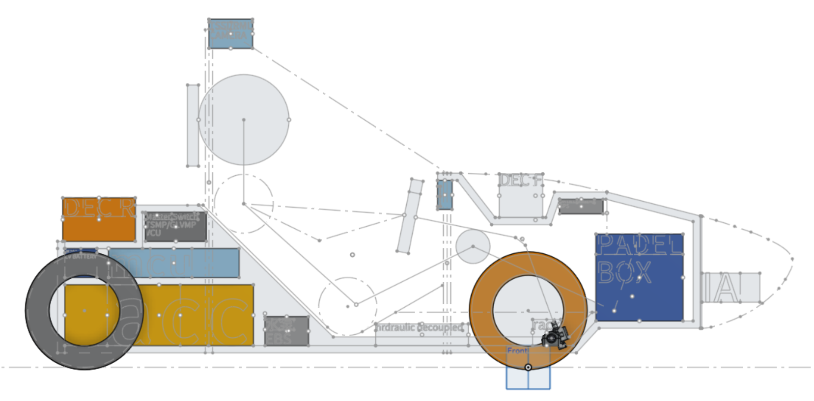

# Basic data source

## 車體

- [簧上質量](../body/Center_of_gravity_LP03_sprung.xlsx)
- [前軸簧下質量](../body/Center_of_gravity_LP03_unsprungfront.xlsx)
- [後軸簧下質量](../body/Center_of_gravity_LP03_unsprungrear.xlsx)

## 輪胎

- [tire.tir](../tire/tire.tir) 為輪胎擬合資料。
- [tire_force_map.pkl](../tire/tire_force_map.pkl) 供 `lapsim_bkup` 查表。
- [hoosier_43075_r20_w8.json](../tire/hoosier_43075_r20_w8.json) 為 `lapsim` 的超橢圓輪胎參數。

## 空力

- [modal_aero.json](../aero/modal_aero.json) 為 `lapsim` 的空力係數。升沉以 m、俯仰和側傾以 rad、空力中心高度以 m 輸入。軸距與平均輪距取自車輛幾何。

## lapsim

- [fsae_A_2025.csv](../track_lapsim/fsae_A_2025.csv) 為兩版圈速模擬共用的賽道分段。
- [input_map.xlsx](../track_lapsim/input_map.xlsx) 為 Lap Tool 的地圖工作簿。
- [vt_data.csv](../track_lapsim/vt_data.csv) 與 [at_data.csv](../track_lapsim/at_data.csv) 為既有的速度與加速度資料。
- [steady_lapsim.pkl](../track_lapsim/steady_lapsim.pkl) 為既有的模擬紀錄，可透過繪圖與訊號匯出腳本的 `--input` 參數讀取。

## 其他

- [motor_speed_vs_torque.csv](../Electrical/motor_speed_vs_torque.csv) 為兩版共用的單顆馬達轉速與扭矩曲線。

目前資料夾內尚無煞車實驗資料與空力圖表。

